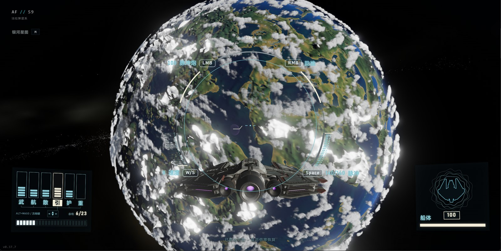

# 深空 · Deep Space

[简体中文](./README.md) | **English**

<p align="center">
  <a href="https://dp.eray.top"></a>
</p>

<p align="center">
  <a href="https://dp.eray.top"></a>
  <a href="LICENSE"></a>
  
  
  
  
  
</p>

A fully procedural universe you can explore seamlessly in the browser. Roll from interstellar space down to any planet's surface and **set foot on any world** — oceans, rivers, ice caps, craters, dunes, lava seas, clouds, rings and moons, all generated from a seed. Leave and come back, the same rock is still there.

Built on native ES modules and Three.js. Runs directly during development and produces a self-contained static deployment to `dist/`. The render pipeline uses WebGL 2.

## Features

- **Curated galaxy**: a finite, deterministic barred-spiral galaxy of exactly **1,024 reachable star systems**, distributed across bulge / bar / main arms / short arms / spurs / disc / halo. Every star system — sun color, planet count, types, orbits, moons, naming — is deterministically generated from catalogue coordinates. Stars visible in the sky are anchored to these 1,024 catalogue points; background stars are a decorative layer jittered from catalogue anchors, with no fake skybox.
- **Eight planet archetypes**: lush, ocean, desert, ice, volcanic, barren, toxic, anomalous. Each planet has its own terrain, palette, liquids, atmosphere, clouds, flora and surface scatter.
- **Seamless scale**: a state machine runs space flight → fly-to-target → landing → walking → takeoff → warp, with no loading screens. The scroll wheel goes from orbit to treetop; speed adapts to altitude.
- **Terrain LOD**: a cubed-sphere quadtree, from the 6 root faces visible at system scale down to level-9 tiles at your feet, all evaluating the same pair of `height` / `colorAt` functions. Tile switches do geomorph — no terrain popping.
- **Volumetric clouds and atmosphere**: near-field clouds are a real 3D density field (sphere-shell ray intersection + lit extinction), degrading to impostors at distance; the sky dome, day/night cycle, sunset, cloud shadows and haze are all driven by a single coverage field.
- **Alien flora**: each planet grows its own species (seeded grammar) — weird trunks, canopies, shrubs, glowing pods, multi-blade grass; near scatter bubbles to a ~4.5 km far proxy layer and on to orbital canopy terrain tinting, with no visible switch.
- **Interstellar travel**: two modes — warp (stellar jump, folding the trip into a direct arrival) and rift (manual boundary traversal); real flight, not teleport. The target star swells from a point of light into a sun, planets materialize frame by frame.
- **Black hole**: Sagittarius A* exists as a destination under its own versioned RNG namespace (`compact-objects:v1`); the event horizon, photon ring and accretion disc are visible in space, without re-rolling any existing star system.
- **Galactic chart**: a full 3D navigation mode (`M` key) exposing the local stellar network, routes, filters, target analysis and a deterministic planet-system view.
- **Ship and HUD**: the HALCYON VII, a 27 m procedural exploration corvette with a full interior, flies in the forward camera view, banking on turns with engine plumes burning by speed; baked PBR textures and vertex-level cavity shadows. A designed ship HUD with power allocation, shields, altitude, pulse and other readouts.
- **Surface weapons and combat HUD**: walk-mode weapon slots, ammo, crosshair.
- **Audio**: 18 scene-scored tracks (see license), lazily loaded per scene and routed through a shared `AudioContext`.
- **Cross-platform input**: desktop (mouse + keyboard) and touch (drag, pinch, virtual stick, buttons) are both fully playable; mobile auto-loads lighter.
- **Quality presets**: Auto / Performance / Balanced / Ultra, judged by real frame rate rather than GPU model.

## Quick Start

```bash
npm install          # Install Node tooling and Playwright
npm run dev          # → http://127.0.0.1:8000 (with dev FPS marker)
```

Any static file server works. `npm run dev` injects a dev-only FPS readout; production builds omit it.

```bash
npm test             # Syntax and version-contract check
npm run test:terrain # Procedural terrain / LOD checks
npm run test:gameplay# Gameplay checks
npm run build        # npm test then recreate deployable dist/
```

Release builds always use the curated `MILKY-038` seed and `milky-way` galaxy (1,024 star systems). Seed overrides are a dev-only world-lab tool: after `npm run dev`, append `?worldlab=1&seed=ANYTHING`; other dev params include `&nolock=1` (no pointer lock), `&galaxy=milky-way`, `&system=0,0,0&body=planet-0&sea=-420&clouds=0.55`. Permanent curation belongs in `src/world-config.js`; keep procedural generators seed-pure.

Headless screenshots and scene validation:

```bash
npx playwright install chromium
npm run shots        # screenshots/ — filter with SEED=… SHOTS=01,05
node tools/sanity.js # Quick node-side check: height stats, LOD consistency, tile build
```

## Controls

### Desktop

| Input | In space | On foot |
|---|---|---|
| **Scroll wheel** | Forward / back — speed adapts to altitude, same wheel from orbit to treetop | — |
| **Drag** | Look around | Look around (after pointer lock, move the mouse) |
| **Left click** | Select / fly to planet · click a distant star to **warp** to its system | — |
| **Right-drag** | Orbit the selected planet | — |
| **WASD** | Slight pan | Walk (**Shift** to run, **Space** to jump) |
| **L** / Land button | Land when low enough | — |
| **T** | — | Take off |
| **M** | Open galactic chart | Galactic chart |
| **H** | Camera mode (hide HUD) | Camera mode |
| **Esc** | Abort fly-to-target / pause | Release mouse / pause |

In space the ship flies directly in front of the camera — banking on turns, engines glowing by speed; it fades out once you're on foot.

### Touch (phone / tablet) (adaptation in progress)

| Gesture | In space | On foot |
|---|---|---|
| **One-finger drag** | Look around | Look around |
| **Pinch** | Forward / back (touch throttle) | — |
| **Tap** | Select / fly to planet · tap a distant star to warp | — |
| **Two-finger drag** | Orbit the selected planet | — |
| **Virtual stick** | — | Walk · push to edge to run |
| **⤊ / 🚀 button** | — | Jump / take off |

Touch devices are auto-detected (`pointer: coarse`); the stick only appears while walking, mobile render resolution is capped, and the Land button works by tap.

## Technical Architecture

### Consistency: every planet is a pair of pure functions

Each planet is defined as two pure functions (seed-derived) over the unit direction on its sphere:

```
height(dir, maxFreq)      -> terrain elevation (metres)
colorAt(dir, h, slope, maxFreq) -> surface color
```

Every sampling builds on the same pair:

- **Terrain LOD** (`src/quadtree.js`): a cubed-sphere quadtree; each tile, from a root face down to level 9, evaluates `height` / `colorAt` on its own grid. `maxFreq` caps noise octaves to the tile's own sampling rate (the first octave of each landform is always kept, so mean elevation and silhouette never jump between LODs). A planet at any distance is literally the same function. LOD switches do geomorph: each tile carries its parent-resolution shape, normals and color as a relative morph target, splitting into the exact parent shape and relaxing to detail (merges animate in reverse) — no terrain popping.
- **Walking** (`src/controls.js`): the ground underfoot is `height(dir)`, not a mesh raycast, so you stand exactly on the terrain you saw from orbit.
- **Liquids**: sea, ice cap and lava are spheres at a seeded sea level; rivers are channels the `height` function carves below sea level, so they flood themselves.
- **Scatter** (`src/scatter.js`): trees / rocks / crystals are placed by hashing the planet's fixed surface cells — leave and return, the same rock is still there.

### Planet-scale floating-point precision

Uses camera-relative rendering: positions live in float64 universe coordinates, the camera stays at the scene origin, and the world repositions around it each frame (plus a logarithmic depth buffer). Tile-local vertex origins and float64 universe coordinates still keep millimetre precision at these scales.

### Scale

Planet radii **30–120 km** (moons 8–20 km) with kilometre-scale regional terrain; planet orbits 900–12,500 km from the sun (sun radius 200–400 km), interstellar spacing ~60,000 km. Large enough that dropping from orbit and trekking across a planet feels planetary, yet compressed so interplanetary hops take minutes and warps cross in seconds.

## Project Structure

| Path | Responsibility |
|---|---|
| `src/main.js` | Game state machine and render loop, camera-relative rendering, ambience |
| `src/rng.js` | Seed hashing + PRNG — the root of all determinism |
| `src/noise.js` | Seeded simplex, fBm / ridged / billow / worley |
| `src/planet.js` | Planet archetypes, `height` & `colorAt`, palettes, water/lava/ice, atmosphere, clouds, rings |
| `src/quadtree.js` | Tile cubed-sphere LOD with skirts, horizon culling and build budget |
| `src/galaxy.js` / `src/galaxy-layout.js` | Universe lattice, star systems, suns, starfield, nebulae |
| `src/sysview.js` / `src/starmap.js` | System view and two-level galactic chart |
| `src/black-hole.js` | Erebus event horizon, photon ring and accretion disc |
| `src/spatial-rift.js` | Rift (manual interstellar traversal) |
| `src/scatter.js` / `src/flora.js` / `src/farflora.js` | Surface scatter and alien flora (near / far layers) |
| `src/clouds.js` / `src/volumetric-pass.js` | Volumetric clouds and coverage field |
| `src/controls.js` / `src/walkdial.js` | Space flight + spherical-gravity first-person walking, walk dial |
| `src/ship-hud.js` / `src/surface-weapons.js` | Ship HUD and surface weapons |
| `src/music.js` / `src/audio.js` | Score catalogue and flight audio |
| `src/world-config.js` | Authored source of the curated universe's identity, special destinations and stable tuning |
| `src/renderer-runtime.js` / `src/renderer-policy.js` | WebGL 2 render runtime and policy |
| `vendor/` | Browser-ready Three.js files; do not edit unless intentionally upgrading the vendored dependency |
| `assets/` | Static models and audio, served at `/assets/...` from the URL root |
| `tools/` | Dev, validation and screenshot scripts |
| `worlds/milky-way.lock.json` | Canonical-universe compatibility snapshot (see below) |

## Canonical Universe Contract

The release universe is the curated `milky-way` galaxy with seed `MILKY-038` and a fixed catalogue of exactly 1,024 reachable star systems. `src/world-config.js` is the authored source for its identity, special destinations and stable `galaxy ID / system ID / body ID` tuning; `src/galaxy-layout.js` is the runtime source for those 1,024 catalogue systems (`buildGalaxyCatalog` enforces `systemCount === 1024`). Do not replace them with another finite baked catalogue or treat a save file as world content.

`worlds/milky-way.lock.json` is the human-readable compatibility snapshot. It records the complete home-system dossier, the authored black-hole destination, the 18 nearest systems, a 64-system neighbourhood profile, home-planet terrain/sea/cloud/ring sentinels, generator versions and a SHA-256 fingerprint. It intentionally does not serialize whole-planet render objects, textures or player state (planetary surfaces are still procedurally generated on demand). Regenerate it only with `npm run world:lock` after intentional re-curation, never merely to make a failing test pass.

Treat seeded outputs and RNG namespaces as content APIs. In particular, changing `rng.js`, `noise.js`, `names.js`, `astronomy.js`, `planet.js`, `galaxy-layout.js`, seed suffixes, probability constants, or the number/order of existing RNG draws can rewrite the selected universe. Add optional content through a new independent namespace where possible. Keep planet adjustments in `world-config.js`.

## License

This project's code is released under the **MIT License**.

### Third-party and exceptions

- **Soundtrack** (18 MP3s under `assets/audio/`, ~117 MB): generated by **Suno AI**. The copyright status of Suno-generated content is still disputed; these tracks are **not** released under the MIT license and are distributed with this project for **non-commercial** use only. See `src/music.js` for the track catalogue and scene bindings. **Forkers note**: obtain your own authorisation before distributing or commercial use, or replace with your own / CC0 tracks; the game still runs after removing the `assets/audio/` directory (audio load failures are silently handled).
- **Three.js**: vendored under `vendor/`, under its MIT license.
