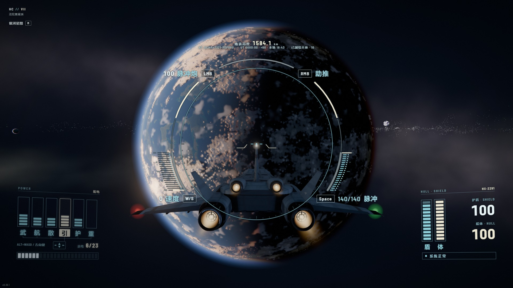

# 深空 · Deep Space

**简体中文** | [English](./README.en.md)

<p align="center">
  <a href="https://dp.eray.top"></a>
</p>

<p align="center">
  <a href="https://dp.eray.top"></a>
  <a href="LICENSE"></a>
  
  
  
  
  
</p>

一个完全过程化、可在浏览器中无缝探索的宇宙。从恒星际空间滚动到任意行星表面并**踏上任何一颗星球**——海洋、河流、冰盖、陨石坑、沙丘、熔岩海、云层、星环与卫星，全部由种子生成，离开再回来，同一块石头还在原地。落地后可以走进边疆前哨补给、在雨里和巡逻机器人交火，也能从云顶跳下去拉伞滑翔。

基于原生 ES 模块与 Three.js 构建，开发期直接运行，也能产出自包含的静态部署到 `dist/`。渲染管线使用 WebGL 2。

## 特性

- **策展银河**：一座有限、确定性的棒旋星系，共 **1,024 个可达恒星系**，按核球/棒/主臂/短臂/ spur/盘/晕分布生成。每个恒星系——太阳颜色、行星数量、类型、轨道、卫星、命名——全部由目录坐标确定性生成。天空中可见的恒星锚定在这 1,024 个目录点上，背景星点是基于目录锚点插值抖动的装饰层，无虚假 skybox。
- **八种陆地行星原型**：繁茂、海洋、荒漠、冰封、火山、荒芜、剧毒、异相。每颗行星拥有独立的地形、调色板、液体、大气、云层、植物与地表散布。气态/冰巨行星不可着陆，但可以一路扎进风暴云层，气压临界时自动驾驶会把船拉回来。
- **人类边疆**：1,024 个恒星系中固定了 **64 个有人星系**——核心都市、轨道枢纽、地表前哨，以及一颗远疆气态巨行星上的浮空城。站点是确定性的内容记录，不是堆出来的烘焙模型；星图、存档与实机看到的是同一批坐标。
- **无缝尺度**：状态机贯穿 太空飞行 → 座舱内走动 → 着陆 → 步行 → 跳伞 → 起飞 → 跃迁，全程无加载。滚轮从轨道到树梢，速度随高度自适应。
- **地形 LOD**：立方球面四叉树，从系统级可见的 6 个根面一路细分到脚下（母星上约 3.6 m 一个顶点，低画质 7.2 m），全部评估同一对 `height` / `colorAt` 函数。分块切换做几何形变（geomorph），无地形跳动。
- **体积云与大气**：近距云层是真实 3D 密度场（天气场驱动、光线步进），远处用分裂的光束/点代理着色；天空穹顶、日夜循环、日落、云影、雾气由同一套大气与天气状态统一驱动。
- **天气**：共享天气场同时决定云量、降雨与地表湿润。雨是受光照的相机面向条带，落地有溅射；地面湿度实时改变反照与粗糙度，并叠出积水与雨滴涟漪。
- **外星植物**：每颗行星生成自己的物种（种子化语法）——怪异树干、冠层、灌木、发光荚果、多叶片草地；近距散布气泡到 ~4.5 km 远景代理层，再到轨道级的冠层染色地形，全程无可见切换。
- **星际旅行**：跃迁（恒星跃迁，折叠航程直接抵达）与弦界航道（真实传送门：开口两侧是同一片空间，手动穿越边界）两种方式；真实飞行而非传送，目标恒星从光点放大为太阳，行星逐帧物化。
- **黑洞**：人马座 A\* 作为独立版本化 RNG 命名空间（`compact-objects:v1`）的目的地存在，事件视界、光子环与吸积盘在太空中可见，不重摇任何既有星系。
- **银河星图**：完整 3D 导航模式（`M` 键），暴露本地恒星网络、航线、过滤器、目标分析与确定性行星系统视图。
- **飞船与内舱**：HALCYON VII 远程探索护卫舰（27.9 m × 21.6 m，Blender 建模、逐顶点烘焙腔体遮蔽与舱内辐照，运行时装配 `assets/halcyon/halcyon.glb`），飞在相机前方，转弯时倾斜、引擎尾焰随速度燃烧。驾驶座、走廊与货舱可完整步行，尾舱坡道能开。设计化舰船 HUD 含配电、护盾、高度、脉冲与受损反馈。
- **舰船与地表武器**：太空用脉冲炮阵列（左键射击）；步行时携带六把模块化武器（PAC-9 LONGSHORE、KR-7 CARBINE、KR-7 VANTAGE、VESPER 9、M12 BREACHER、STRIX 9），共享第一人称手套骨架与程序化瞄具/枪口/挂件，可瞄准、换弹、切枪、收枪并投掷破片手雷。
- **前哨与战斗**：地表前哨有工业道具、居住舱家具、可击碎的玻璃与会爆的物件，巡逻的猎犬/海鸥机器人会开火；殖民者与 K9 单位在场。战斗 HUD 给出弹药、准星与命中反馈。
- **高空跳伞**：云顶悬停离舱，自由落体、手动开伞、拉刹车带转向——从轨道到坡道再到伞下没有一次加载。
- **音频**：42 首场景化配乐（27 首 Lyria 3.5 + 15 首经典曲目，详见许可证），按场景懒加载；武器、雨与脚步等程序化音效经共享 `AudioContext` 路由。
- **跨平台输入**：桌面（鼠标 + 键盘）与触屏（单指转向、双指推进、虚拟摇杆、环形按钮）都可玩；移动端自动降负载。
- **画质档位**：自动 / 性能 / 均衡 / 极致，依据实际帧率而非 GPU 型号判定。

## 快速开始

```bash
npm install          # 安装 Node 工具与 Playwright
npm run dev          # → http://127.0.0.1:8000（带开发 FPS 标记）
```

任何静态文件服务器均可：`npm run dev` 会注入仅开发期可见的 FPS 读数，生产构建不含。

```bash
npm test               # 契约检查（纯 Node，约 30 s：目录、文明站点、渲染状态机、版本）
npm run test:terrain   # 过程化地形 / LOD 检查
npm run test:gameplay  # 玩法检查
npm run test:smoke     # 一次无头 Chromium 启动（着色器、生成、渲染、输入、暂停 UI，约 1 min）
npm run test:full      # 全部浏览器套件：玩法、指针锁定、星图、弦界、星历、系统视图、接缝、触屏、飞船
npm run build          # npm test 后重建可部署的 dist/
```

发布构建始终使用策展过的 `MILKY-038` 种子与 `milky-way`（银河系，共 1,024 个恒星系）。种子覆写是仅开发期的世界实验室工具：`npm run dev` 后用 `?worldlab=1&seed=ANYTHING`（可再加 `&galaxy=milky-way`、`&system=0,0,0&body=planet-0`）；其他开发参数含 `&nolock=1`（无指针锁定）、`&quality=low`、`&post=0`、`&vclouds=0`、`&renderlook=legacy`。永久策展内容应落在 `src/world-config.js`，过程化生成器保持种子纯净。

无头截图与场景验证：

```bash
npx playwright install chromium
npm run shots            # screenshots/ — 可用 SEED=… SHOTS=01,05 过滤
node tools/ship-shots.js # 舰船 beauty 机位
node tools/sanity.js     # 快速节点侧检查：高度统计、LOD 一致性、分块构建
```

## 操作

### 太空飞行

| 输入 | 作用 |
|---|---|
| **鼠标** | 船头指向（座舱视角下按住右键可自由环视） |
| **W / S · A / D** | 推进 / 制动 · 侧推 |
| **滚轮** | 微调推进——速度随高度自适应，同一滚轮从轨道到树梢 |
| **左键** | 脉冲炮射击 |
| **右键 / Shift** | 加力 |
| **Space** | 脉冲冲刺（按住蓄力） |
| **L / Shift + L** | 低空自动着陆 / 在当前位置定高悬停；崎岖地形或 420 米以上自动转为悬停 |
| **V** | 座舱 / 追尾视角切换 |
| **M / Tab** | 打开银河星图 |
| **H** | 相机模式（隐藏 HUD） |
| **Esc** | 中止航线 / 暂停 |

桌面左键专属于开火，选择目标走星图（`M`）或触屏点按。飞船在太空中飞在相机正前方——转弯时倾斜，引擎随速度发光；踏上行星后淡出。

### 步行 / 地表

| 输入 | 作用 |
|---|---|
| **WASD** | 行走（**Shift** 奔跑，**Space** 跳跃，**C / Ctrl** 蹲伏） |
| **左键 / 右键** | 开火 / 瞄准（ADS） |
| **1–6 / 滚轮** | 切换武器 |
| **R / G** | 换弹 / 收枪 |
| **Q** | 破片手雷 |
| **F** | 交互：开尾舱门、登舰、坐入驾驶座 |
| **T** | 召回飞船 |
| **M / H / Esc** | 星图 / 相机模式 / 释放鼠标或暂停 |

### 舱内与落地

| 输入 | 作用 |
|---|---|
| **WASD · Shift** | 舱内移动 · 疾行 |
| **F** | 坐入驾驶座 / 开关尾舱门 |
| **Space / W** | 在驾驶座点火起飞 |
| **V** | 切换视角 |

**云上跳伞。** 在有云的行星上飞到云顶，按 **L** 悬停，也可以在暂停菜单选择「在此悬停跳伞」。按 **F** 离座，走到尾舱按 **F** 开门，沿坡道跃出。自由落体时按住 **W** 收身俯冲，松开恢复普通下降。**Space / F** 开伞，**A / D** 拉动对应的刹车带转向，**S** 双手拉平减速。自动开伞装置根据下降速度预留开伞高度。

### 触屏（手机 / 平板）

| 手势 | 太空中 | 步行时 |
|---|---|---|
| **单指拖** | 环视 / 转向 | 环视 |
| **捏合** | 前进/后退（触屏油门） | — |
| **点按** | 选择 / 飞向行星 · 点远处恒星跃迁 | — |
| **双指拖** | 环绕选中行星 | — |
| **虚拟摇杆** | — | 行走 · 推到边缘奔跑 |
| **⤊ / 🚀 按钮** | — | 跳跃 / 起飞 |

触屏通过 `pointer: coarse` 自动识别：触屏环形控件只在地表步行时出现，移动端渲染分辨率有上限。飞行时点 **Ⅱ** 打开航行菜单选择悬停；用「起身」「交互」和摇杆走出尾舱，前推摇杆俯冲，点「开伞」展开翼伞，左右控伞，后拉减速。

## 技术架构

### 一致性：每个行星是一对纯函数

每颗行星被定义为关于其球面上单位方向的两个纯函数（由种子派生）：

```
height(dir, maxFreq)      -> 地形起伏（米）
colorAt(dir, h, slope, maxFreq) -> 表面颜色
```

一切采样都基于同一对函数：

- **地形 LOD**（`src/quadtree.js`）：立方球面四叉树，每个分块从根面一路细分到脚下，在其网格上评估 `height` / `colorAt`。`maxFreq` 按分块自身采样率封顶噪声倍频（每种地貌的首倍频始终保留，故平均海拔与轮廓永不在 LOD 间跳变）。一颗行星在任何距离下字面上就是同一个函数。LOD 切换做几何形变：每个分块携带父级分辨率的形状、法线与颜色作为相对形变目标，分裂以父级精确形状出现并松弛为细节（合并亦反向动画）——无地形跳动。
- **步行**（`src/controls.js`）：脚下的地面是 `height(dir)`，而非网格射线检测，因此你精确站在轨道上看到的地形上。
- **液体**：海、冰盖、熔岩是种子化海平面处的球体；河流是 `height` 函数在海平面之下刻出的河道，故自行泛滥。
- **散布**（`src/scatter.js`）：树/岩石/晶体按行星固定表面单元格哈希放置——离开再回来，同一块岩石还在原地。

### 行星尺度浮点精度

采用**相机相对渲染**：位置存于 float64 宇宙坐标，相机停在场景原点，世界每帧围绕它重新定位（外加对数深度缓冲）。分块局部顶点原点与 float64 宇宙坐标在这些尺度下仍保持毫米精度。

### 尺度

岩质行星半径 **160–400 km**（母星按策展固定为 1,200 km）；气态/冰巨行星 620–1,700 km，卫星 28–150 km。行星轨道渲染半径从 **60,000 km** 起步、按 1.68× 逐颗外推至 1,600,000 km；恒星系按 **4×10⁶ km** 的目录晶格排布。大到从轨道降落并徒步穿越一颗星球有行星感，又压缩到行星际飞行只需数分钟、跃迁数秒跨越。

## 项目结构

| 路径 | 职责 |
|---|---|
| `src/main.js` | 游戏状态机与渲染循环、相机相对渲染、氛围与输入接线 |
| `src/rng.js` | 种子哈希 + PRNG——一切确定性的根 |
| `src/noise.js` | 种子化 simplex、fBm / ridged / billow / worley |
| `src/planet.js` | 行星原型、`height` & `colorAt`、调色板、水/熔岩/冰、大气、云、星环 |
| `src/quadtree.js` | 带 skirt、地平剔除、构建预算的分块立方球面 LOD |
| `src/astronomy.js` / `src/galaxy.js` / `src/galaxy-layout.js` | 星历与天体规格、宇宙晶格、太阳、星空、星云 |
| `src/sysview.js` / `src/starmap.js` | 系统视图与两级银河星图 |
| `src/black-hole.js` | 人马座 A\* 的事件视界、光子环与吸积盘 |
| `src/portal/` / `src/warp-conduit.js` | 弦界航道传送门（几何、映射视图、逐像素合成）与跃迁通道 |
| `src/civilization.js` / `src/artificial-sites.js` | 64 个有人星系的内容记录与人工站点实例化 |
| `src/scatter.js` / `src/flora.js` / `src/farflora.js` / `src/vegetation/` | 地表散布、外星植物近/远层、树种与扰动 |
| `src/cloud/` / `src/clouds.js` / `src/volumetric-pass.js` | 体积云实现、云种、天气场与体积渲染 |
| `src/weather/` / `src/weather-effects.js` | 降雨、湿地面与天气演出 |
| `src/controls.js` / `src/walkdial.js` / `src/skydive.js` / `src/skydive-rig.js` | 飞行与球面重力第一人称步行、勘测表盘、跳伞与伞具 |
| `src/effects.js` / `src/ship-hud.js` | 舰船与脉冲炮、舰船 HUD |
| `src/ship-view.js` / `src/halcyon/` | 内舱行走、尾舱坡道、GLB 装配、舱内辐照与飞船音频 |
| `src/surface-weapons.js` / `src/weapons/` | 六把地表武器、第一人称手套骨架、程序化武器几何与武器音效 |
| `src/surface/` | 前哨与居住道具、可破坏物、机器人、殖民者与 K9、地表玩法协调 |
| `src/music.js` / `src/audio.js` / `src/audio/` | 配乐目录、飞行音频与程序化音效 |
| `src/world-config.js` | 策展宇宙的身份、特殊目的地与稳定调参来源 |
| `src/renderer-runtime.js` / `src/renderer-policy.js` | WebGL 2 渲染运行时与策略 |
| `tools/blender/` | HALCYON VII 的 Blender 建模与 GLB 打包脚本 |
| `vendor/` | 浏览器版 Three.js 文件，除非有意升级依赖否则勿改 |
| `assets/` | 静态模型（含 `halcyon/halcyon.glb`）、贴图与音频，以 `/assets/...` 提供于 URL 根 |
| `tools/` | 开发、校验、性能与截图脚本 |
| `THIRD_PARTY_NOTICES.md` | 第三方素材来源与许可：配乐、Three.js |
| `worlds/milky-way.lock.json` | 规范宇宙兼容性快照（见下） |

## 规范宇宙契约

发布宇宙是策展过的 `milky-way` 星系，种子 `MILKY-038`，目录固定 1,024 个恒星系。`src/world-config.js` 是其身份、特殊目的地与稳定 `galaxy ID / system ID / body ID` 调参的成文来源；`src/galaxy-layout.js` 是这 1,024 个目录系统的运行时来源（`buildGalaxyCatalog` 强制 `systemCount === 1024`）。不要用其他有限烘焙目录替换它们，也不要把存档当作世界内容。64 个有人星系同样是确定性内容记录（`src/civilization.js`），星图、系统视图与实机看到的是同一批站点。

`worlds/milky-way.lock.json` 是人类可读的兼容性快照，记录完整的母系档案、成文黑洞目的地、18 个最近星系、64 系统邻域剖面、64 个文明站点、母星地形/海/云/环哨兵、生成器版本与 SHA-256 指纹。它**不**序列化整颗行星的渲染对象、纹理或玩家状态（行星表面仍按需过程化生成）。仅在有意重新策展后用 `npm run world:lock` 重建，绝不为让失败测试通过而重建。

种子化输出与 RNG 命名空间应被当作内容 API 对待。具体而言，改动 `rng.js`、`noise.js`、`names.js`、`astronomy.js`、`planet.js`、`galaxy-layout.js`、种子后缀、概率常量或既有 RNG 抽取的数量/顺序，都可能改写被选中的宇宙。尽可能通过新的独立命名空间添加可选内容。行星调整保留在 `world-config.js`。

## 许可证

本项目代码以 **MIT License** 发布。

### 第三方与例外

- **配乐**（`assets/audio/` 下 42 首 MP3，约 250 MB）：27 首由 **Google DeepMind Lyria 3.5**（经 Google Flow Music）生成，15 首为早期 **Suno AI** 曲目。AI 生成音乐的版权状态因法域与服务条款而异，这些曲目**不**随 MIT 许可发布，仅按**非商业**用途随本项目分发。完整曲目表与场景绑定见 `THIRD_PARTY_NOTICES.md` 与 `src/music.js`。**Fork 者注意**：自行分发或商业使用前须另行获取授权，或替换为自有 / CC0 曲目；移除 `assets/audio/` 目录后游戏仍可运行（音频加载失败被静默处理）。
- **Three.js**：vendored 于 `vendor/`，遵循其 MIT 许可。
